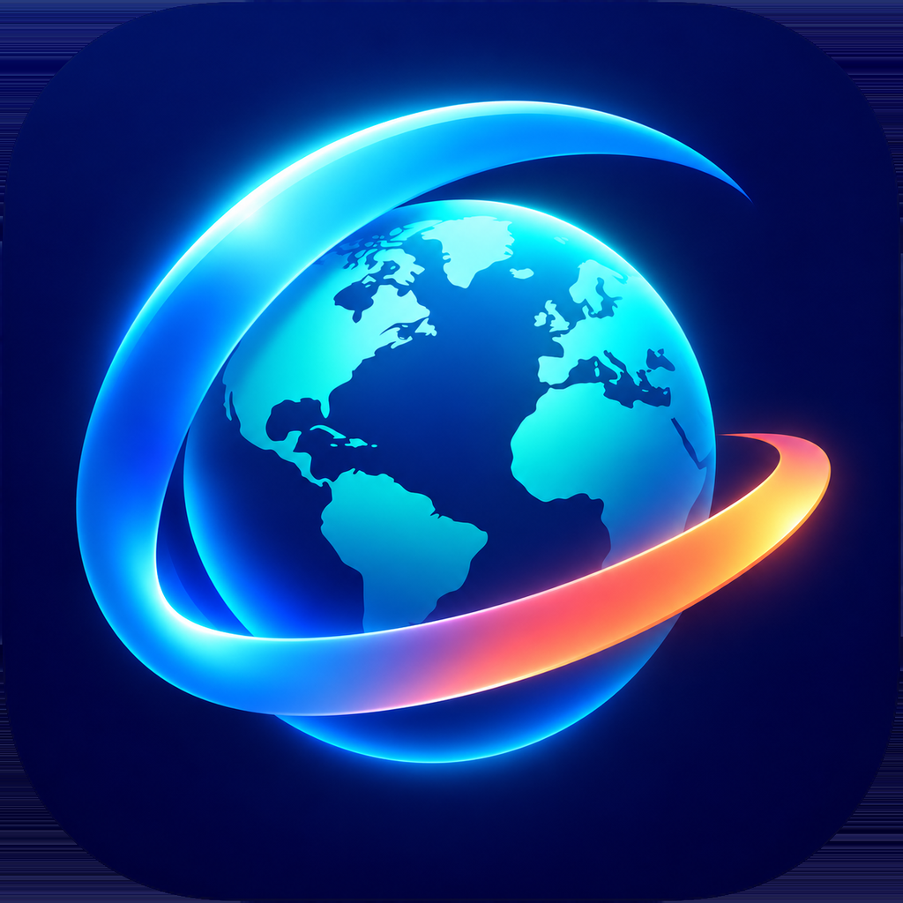

# Chougmium



**A standalone Chromium 150 browser for jailbroken iPad 2 / iOS 9.**  
An independent packaging and compatibility edition of [Venetium for iOS](https://github.com/Computershik73/Venetium-iOS), not Google Chrome.

[Install from your iPad](https://godsquantum.github.io/Chougmium-iOS/) · [Releases](https://github.com/GodsQuantum/Chougmium-iOS/releases) · [Source and credits](#source-and-license)

## Features

- Chromium/Blink and V8 run on the device, not on a remote browser server.
- Original Venetium browser engine, bookmarks, multiple tabs and built-in filter list.
- Rootful browser package preserves the upstream app identity, executable and profile path.
- Scoped iOS 9 keyboard compatibility fix for the missing UIWindow coordinateSpace selector.
- Chougmium icon, new-tab and About branding.
- Optional tab-controls repair: native Close tab menu and corrected close-button touch handling.

## Install on the iPad

Requires a jailbroken iOS 9 device with Cydia and MobileSubstrate. Tested installation target: iPad 2, iOS 9.3.5, ARMv7.

1. In Safari, open **[the installation page](https://godsquantum.github.io/Chougmium-iOS/)**.
2. Add the Cydia source `https://godsquantum.github.io/Chougmium-iOS/`.
3. Install **Chougmium**. Optionally install **Chougmium Tab Controls Repair** from the same source.
4. Open Chougmium from the Home screen.

If a package-manager link does not work, use Cydia's Sources > Edit > Add, then search for Chougmium. No computer or remote browser service is required once Cydia and its dependencies are installed.

### Direct downloads

- [Chougmium 150.7871.222.1+chougmium3 (.deb)](https://github.com/GodsQuantum/Chougmium-iOS/releases/download/v150.7871.222.1-chougmium3/ru.computershik.venetium_150.7871.222.1%2Bchougmium3_iphoneos-arm.deb)
- [Optional tab-controls repair (.deb)](https://github.com/GodsQuantum/Chougmium-iOS/releases/download/v150.7871.222.1-chougmium3/com.local.chougmium-tabsfix_0.1.0_iphoneos-arm.deb)

A downloaded .deb requires a compatible package installer; stock iOS cannot install it directly. Do not install over an unrelated browser or force package dependencies. This package intentionally shares Venetium's bundle/package identity and replaces that edition, rather than creating a second profile.

## Compatibility and known limitations

iOS 9.x, ARMv7, rootful jailbreak. A package installed successfully and the browser has been observed running on iPad 2 / iOS 9.3.5. The original Chromium executable is unchanged. The keyboard repair is narrowly scoped; not every modern site or media format is supported. With the iPad 2's 512 MB RAM, complex web apps and many tabs can be slow or terminate under memory pressure. Do not use an old jailbroken device as a security-sensitive daily browser. No promise of current Chrome security updates, extensions or Google account sync.

The native tab repair is optional and can be removed independently; restart the browser after installing/removing it. Do not modify the system partition or globally weaken TLS.

## Screenshots

The icon above is the shipped app artwork, not a screenshot. Genuine screenshots of this release will be added after capture on the device; no simulated interface is represented as real.

## Build and verify

Build the scoped UIKit shim with Theos (ARMv7 toolchain and iPhoneOS10.3 SDK), then repackage the exact verified upstream .deb. The repackager requires Python 3, dpkg-deb, ar and FFmpeg; it refuses a mismatching upstream SHA-256. The corresponding source of the original engine is described below.

```sh
export THEOS="$HOME/.local/share/theos"
./scripts/build.sh
python3 scripts/build_chougmium.py
python3 scripts/build_chougmium_tabfix.py --theos "$THEOS"
cp releases/com.local.chougmium-tabsfix_0.1.0_iphoneos-arm.deb docs/debs/
python3 scripts/build_feed.py
python3 tests/test_chougmium_package.py
python3 tests/test_chougmium_tabfix.py
python3 tests/test_feed.py
```

## Source and license

This distribution preserves the original Venetium Chromium binary. Original app and engine integration by the Venetium-iOS authors and Computershik73. The upstream corresponding source is the [version 150.7871.222.1 commit 20d7340](https://github.com/Computershik73/Venetium-iOS/tree/20d7340140aaeb59b00e392f6bca6dd6568b4c9a), including its Chromium patches and build scripts that fetch the pinned engine source. [Download the upstream source snapshot](https://github.com/Computershik73/Venetium-iOS/archive/20d7340140aaeb59b00e392f6bca6dd6568b4c9a.tar.gz). Follow the upstream build instructions and notices for Chromium and its third-party components. The local compatibility changes, packaging scripts and build instructions are available here under GPL-3.0. The original third-party filter license is retained in the application.

[Local patch source archive](https://godsquantum.github.io/Chougmium-iOS/source/Chougmium-patches.tar.gz) · [GPL-3.0](LICENSE)

Chougmium is a community project, not affiliated with Google or Apple.
